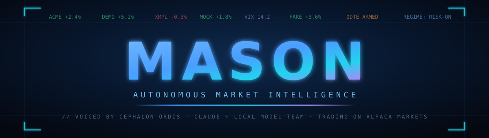
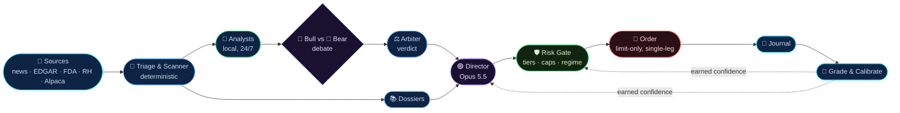

<!-- ░▒▓█ MASON █▓▒░ -->
<div align="center">



<br/>

<!-- ── Badges ─────────────────────────────────────────── -->
<a href="#-getting-started"></a>


<br/>


<br/><br/>

### `>` A multi-agent, voice-driven market desk that runs around the clock — hunting setups, arguing both sides, sizing the risk, and grading its own calls.

<em>Sources → Analysts → Bull vs. Bear → Arbiter → Director → Risk Gate → Order → Journal → Grade</em>

</div>

---

> ```
> ORDIS: Good morning, Operator! The desk worked through the night — the
>        analysts flagged two catalysts, the bulls and bears have already
>        argued them out, and the Director is reviewing the dossiers for the
>        7:00 anchor. The paper book is reconciled. Shall I walk you through it?
> ```

---

## 🛰️ What is Mason?

**Mason** is a personal, always-on **investment co-pilot**: a small trading desk made of cooperating AI agents, each with its own job. You talk to him (out loud or by typing) and he reads the tape, screens for setups, pulls SEC filings, prices options, debates the thesis, sizes the position, places the **paper** order, and **logs every prediction so it can be graded later**.

Underneath, Mason is a **team of eight models** — four running locally on his own GPU, four from Anthropic's Claude API — each working inside a defined scope, so cheap, fast work stays local and the expensive thinking is saved for the moments that deserve it.

He has a personality — modeled on **Ordis**, the loyal (and occasionally glitchy) Cephalon from *Warframe* — so it feels less like a dashboard and more like a friendly crew member who happens to be very good at math.

The **north star:** out-trade the S&P 500 with disciplined, defined-risk plays — short-term equity swings and **single-leg options (including 0DTE)** — while never pretending a guess is a fact.

> [!IMPORTANT]
> **This is a research & paper-trading project — not financial advice, and not a live-money bot.** Every order routes to an **Alpaca paper account**. Brokerage access to Robinhood is **read-only**. Nothing here is a recommendation for you.

---

## 🧠 The Model Roster

Every model call goes through one gateway (`mason_llm.py`). Callers ask for an *intent*, never a model name, and the gateway routes it to the agent whose scope fits.

<div align="center">

| | Model | Runs on | Scope |
|:---:|---|---|---|
| 🟢 | **qwen3.5:4b** | Local · Ollama | **The workhorse.** Drives the interactive tool loop, the 24/7 analysts, news triage, Bull/Bear debate, the arbiter, and Ordis's voice. |
| 🟡 | **phi4-mini** | Local · Ollama | **The understudy.** Steps in for text work whenever the workhorse is busy or unavailable, so the desk never goes quiet. |
| 🔬 | **qwen3:8b** | Local · Ollama | **Challenger lane.** Benchmarked head-to-head against the workhorse on extraction, self-correction and tool-calling — the bench for future promotions. |
| 🔬 | **qwen2.5:7b** | Local · Ollama | **Challenger lane.** A second benchmark candidate, scored by the same harness so model upgrades are earned, not assumed. |
| 🟣 | **Claude Opus 5.5** | Anthropic API | **The Director.** Deep analysis only — the Catalyst Desk's research-grade calls, the Predictor, and any question the workhorse escalates. |
| 🔵 | **Claude Sonnet 5.5** | Anthropic API | Full tool-wielding chat brain, selectable from the chat bar. |
| 🔵 | **Claude Fable 5.2** | Anthropic API | Full tool-wielding chat brain, selectable from the chat bar. |
| ⚪ | **Claude Haiku 5.5** | Anthropic API | Quick, low-cost answers from the chat bar. |

</div>

**Two routing rules keep the team honest:**

- **Capability** — if a job is too hard for the workhorse, it escalates *up* to the Director (Opus).
- **Availability** — if the workhorse is down, work falls *sideways* to the understudy, then retries.

The two never cross: Opus is never used just because a local model is busy, and a fallback is never treated as an upgrade. A model picker in the chat bar lets you hand the conversation to any of the chat-capable models.

---

## ⚡ What Mason Actually Does

| | Capability | What it means |
|---|---|---|
| 🗣️ | **Voice-first co-pilot** | Speak to Mason; he speaks back in the Ordis voice. Barge-in, live status ring, incremental speech. |
| 🧰 | **~70 tools** | 54 core tools plus feature tool packs (Robinhood, watchlist, theses, memory search, ETF allocator) that switch on with their feature. |
| 🏢 | **24/7 Analyst Desk** | Local analysts scan their tickers around the clock, report into a durable inbox, and watch the health of every data source. |
| 🐂🐻 | **Adversarial review** | On breaking, book-relevant news: news → thesis → **Bull vs. Bear debate** → **Arbiter** verdict → a draft recommendation that gets graded later. |
| 🔎 | **Fact-checking** | A fact-check toolkit re-verifies claims before they reach you, with an in-chat "Fact Checking…" badge. |
| 🎯 | **Catalyst Desk** | Free structured sources → deterministic triage → research dossiers → the **Opus Director** issues calls at the 07:00 and 13:00 ET anchors, with follow-ups and a lessons memory. |
| 🤖 | **Approve-to-place autotrade** | The Director's calls flow through a sizing-tier risk gate into paper orders — with hard caps on size, exposure, trades per day and daily loss. |
| 🛡️ | **Regime gate** | Decides *how big* to be — full size when healthy, smaller when shaky, cash-priority when the tape is red. |
| 📊 | **Real options intel** | Live chains (0DTE-ready), real greeks & open interest, expected move, probability-of-profit, IV-vs-realized read, and option price paths for MFE/MAE grading. |
| 📄 | **SEC EDGAR** | Filing finder + section reader (S-1, 424B, 10-K), a live 8-K poller, and EDGAR-native 13F institutional flow. |
| 👀 | **Live watchlist** | 1-minute bars streamed over the Alpaca websocket, a signals layer, digests, and a `watch_tape` tool: *"What's HOOD's tape been doing?"* |
| 🪶 | **Read-only Robinhood link** | Mason is his own OAuth client of Robinhood's official MCP server: history, Paper-vs-Real report card, Behavior Coach, What-If replayer, PEAD, market regimes, congress trades, crowd tracker, scanner intake. |
| 📰 | **Constant news service** | Ticker-tagged headlines scored against *your* book, a headline-first brief, and a material-news bridge into the inbox. |
| 🧠 | **Memory spine** | Long-lived theses with a deterministic matcher, durable facts, market-intelligence memory, and whole-database search. |
| 🩺 | **Self-healing** | A self-check job runs every ~15 minutes and repairs what it safely can; retention jobs keep the database lean. |

---

## 🧬 The Ordis Layer

Mason isn't a neutral chatbot. His greetings, prefixes and spoken summaries are generated live by the local workhorse model to stay in character as a Cephalon — warm, precise, eager to help, and every so often glitching mid-sentence into something a little too honest before snapping back to duty.

```
ORDIS: Your XLE position is up 6%! I am — [̷D̷E̷L̷I̷G̷H̷T̷E̷D̷] — pleased to report
       the thesis is playing out. The regime gate remains RISK-ON. Shall I
       suggest a trailing stop, Operator?
```

It's a **fail-safe cosmetic layer** — if the generator ever hiccups, static lines take over and nothing breaks.

---

## 🏗️ Architecture — A Desk of Agents

Mason separates the *generative* step (having an idea) from the *adversarial* step (trying to kill it), the *mechanical* step (sizing & executing) and the *evidentiary* step (logging & grading). Each stage only proceeds on a valid, gated output from the one before.



**The agents and their jobs:**

| Agent | Role |
|---|---|
| 📡 **Scanner** | Discovery, not judgment — sweeps the universe and the vendored trading skills for candidates. |
| 🔮 **Predictor** | Turns the best candidate into one falsifiable thesis (deep tier). |
| 🏢 **Analysts** | Per-ticker local analysts that write the hourly and anchor Desk Reports. |
| 🐂 **Bull** / 🐻 **Bear** | Argue the thesis from opposite sides — the core anti-overconfidence tool. |
| ⚖️ **Arbiter** | Reads the debate and issues a verdict; escalates to Opus when the stakes warrant it. |
| 🔎 **Fact-checker** | Re-verifies claims against sources before they're trusted. |
| 🟣 **Director** | Research-grade calls from the dossiers at each anchor, with follow-ups and lessons. |
| 🛡️ **Risk gate** | Deterministic sizing tiers, exposure caps, the regime gate and the daily loss stop. |
| 🤖 **Agent loop** | Deterministic (no model) placement, exits and calibration around autotrade. |
| 🩺 **Self-check** | Watches the whole system and repairs what it safely can. |

The design borrows deliberately from published multi-agent trading research:

| Source | What Mason borrows |
|---|---|
| **TradingAgents** (Tauric) | Bull/Bear debate as the core anti-overconfidence tool; reflection-memory feeding future reasoning |
| **AI Hedge Fund** (virattt) | Different reasoning lenses over the same data surface disagreement; a portfolio-manager-style final arbiter |
| **FinRobot** (AI4Finance) | Cost routing — cheap models for mechanical steps, premium models reserved for genuine synthesis |

---

## 🗺️ Under the Hood — Module Map

Mason is a Flask app (`mason_app.py`) orchestrating ~80 focused modules.

| Group | Modules |
|---|---|
| 🧠 **Brain & models** | `mason_app` (server, chat loop, tool registry, voice UI) · `mason_llm` (model gateway & routing) · `mason_voice` (Ordis lines) · `mason_trace` (workflow tracing) |
| 🏢 **Analyst Desk** | `mason_analyst_desk` · `mason_desk_pipeline` · `mason_debate` · `mason_arbiter` · `mason_factcheck` · `mason_notifications` · `mason_health` · `mason_activity` |
| 🎯 **Catalyst Desk** | `mason_sources` · `mason_triage` · `mason_dossier` · `mason_director` |
| 🔮 **Agents & ideas** | `mason_scanner` · `mason_scanner_skills` · `mason_predictor` · `mason_ideas` · `mason_skills` · `mason_neglected_value` |
| ⚙️ **Execution & journals** | `mason_execution` · `mason_order_builder` · `mason_autotrade` · `mason_agent_loop` · `mason_agent_report` · `mason_options` · `mason_trades` · `mason_db` |
| 🔁 **Learning & grading** | `mason_learning` · `mason_price_cache` · `mason_option_bars` · `mason_kb_priors` · `mason_regimes` · `mason_pead` |
| 🪶 **Robinhood (read-only)** | `mason_robinhood` · `mason_rh_history` · `mason_rhx_integration` · `mason_pvr` · `mason_behavior` · `mason_whatif` · `mason_exposure` · `mason_congress` · `mason_crowd` · `mason_scanners` |
| 👀 **Watchlist** | `mason_watchlist` · `mason_watch_tape` · `mason_watch_signals` · `mason_watch_api` · `mason_watch_chat` |
| 🌡️ **Markets & news** | `mason_regime_gate` · `mason_market_posture` · `mason_news_service` · `mason_news` · `mason_brief` · `mason_brief_triage` · `mason_edgar` · `mason_institutional_flow` · `mason_allocator` · `mason_etf_screen` |
| 🧠 **Memory** | `mason_theses` · `mason_memory_store` · `mason_memory_search` · `mason_intelligence` · `mason_transcript` · `mason_agenda` |
| 🩺 **Ops** | `mason_selfcheck` · `mason_maintenance` · `mason_startup` · `mason_secrets` · `mason_redact` · `mason_ui_layout` |

---

## 🧰 The Toolbelt

Chat-capable models can call **54 core tools**, plus feature packs that appear only while their feature is enabled.

<table>
<tr>
<td valign="top" width="33%">

**📈 Market Data**
- `get_quote` · `verify_quote`
- `get_price_history`
- `get_macro` · `get_sectors`
- `get_earnings` · `get_news`
- `search_web` · `get_date_info`
- `get_market_posture`
- `get_latest_scan` · `hunt_setups`
- `get_sec_filing` · `run_brief`

**🧨 Options**
- `get_option_chain`
- `get_alpaca_option_contracts`
- `estimate_option_odds` · `get_vol_context`
- `cross_check_option_play`
- `log_options_play` · `place_and_log_option_play`
- `review_options_play` · `close_options_play_early`
- `get_options_journal` · `delete_options_play`
- `backfill_verified_option_play`

</td>
<td valign="top" width="33%">

**⚙️ Execution & Book**
- `place_paper_order` · `cancel_paper_order`
- `get_paper_orders` · `get_paper_account`
- `close_paper_position` · `liquidate_paper_position`
- `reconcile_alpaca`
- `log_stock_trade` · `close_stock_trade`
- `get_stock_trades` · `delete_stock_trade`
- `set_hold_directive`

**🏦 Personal Positions**
- `get_personal_positions`
- `stage_personal_position` · `confirm_personal_position`
- `stage_close_personal_position`

</td>
<td valign="top" width="33%">

**🧠 Intel, Memory & Ops**
- `get_accuracy_report` · `get_trade_accuracy`
- `save_market_intelligence` · `recall_market_intelligence`
- `recall_material_news`
- `remember_fact` · `recall_memory`
- `set_reminder` · `resolve_reminder`
- `read_uploaded_file` · `get_self_check`

**🧩 Feature packs**
- 🪶 Robinhood: positions · quote · watchlists · congress · what-if · behavior · priors · trade stories
- 👀 Watchlist: show · add · remove · `watch_tape`
- 📌 Theses: add · list · close
- 🔍 Memory: `search_memory` · `query_db`
- 💼 Index desk: `allocate_cash` · `etf_screen`

</td>
</tr>
</table>

---

## 📊 The Strategy Playbook

Mason runs a **pipeline, not a pile of signals** — the way a real desk operates: *don't buy in a downtrend → screen → confirm → debate → size → track.*

```
  ①  GATE       Regime filter FIRST  ──►  risk-on / neutral / risk-off posture
                market-top + breadth + macro-regime   →  sizes every idea
                    │
  ②  HUNT       Momentum / breakout core  ──►  VCP · CANSLIM · theme-detector
                    │
  ③  HUNT       Event drift  ──►  PEAD · earnings · catalysts  (news as a filter, not a chase)
                    │
  ④  HUNT       Neglected value sleeve  ──►  cheap + low-coverage + early institutional flow
                    │
  ⑤  CHALLENGE  Bull vs. Bear  ──►  Arbiter verdict  ──►  Director call
                    │
  ⑥  EXPRESS    Sizing & options  ──►  risk tiers  +  single-leg call/put
                    │
  ⑦  LEARN      Close the loop  ──►  log every call → grade it → recalibrate
```

**The honest edge ranking** Mason is built on:

| Strategy | Edge (evidence) | Fit for a small momentum account |
|---|:---:|:---:|
| Trend / momentum (cross-sectional) | ★★★★★ | ★★★★★ |
| Post-Earnings Drift (PEAD) | ★★★★★ | ★★★★☆ |
| Regime / trend filter (don't fight the tape) | ★★★★★ | ★★★★★ |
| Value (cheap multiples) | ★★★★☆ | ★★☆☆☆ |
| Neglected-firm / low coverage | ★★★☆☆ | ★★★☆☆ |
| Breaking-news *spike* chasing | ★☆☆☆☆ | ★☆☆☆☆ ⛔ retail trap |

---

## 🎯 Trading Policy — "Work Like Real Investors"

A standing mandate governs every order Mason places:

> 🔒 **Single-leg options only** — one long call *or* one long put, on one ticker. No spreads, no multi-leg, no writing premium.
>
> 🔒 **Limit orders only** — every entry and exit rests at an explicit price. **No market orders, ever.**
>
> 🔒 **One ticker per trade** — no pairs, no baskets, no combo tickets.
>
> 🔒 **Hard risk caps on autotrade** — per-trade size limits by confidence tier, a cap on total open exposure, a maximum number of trades per day, a daily loss stop, no new margin, and 0DTE only on the most liquid index ETFs.

**Why:** a long option's max loss is the premium paid — defined-risk by construction — and a limit order is the only way to know your fill *before* it happens. These rules are enforced in code (the execution layer rejects market orders; tool schemas require a limit price and restrict strategies to `long_call` / `long_put`), not just in the prompt.

---

## 🔁 The Self-Learning Loop

Mason grades himself — continuously, objectively, and in the open. His track record lives inside the app (accuracy reports, the Paper-vs-Real report card, and the agent-loop status widget) and grows with every trading day.

```
  PREDICT    Every call = a falsifiable prediction
             (entry / stop / target / horizon / setup / confidence)
                │
  RESOLVE    Walk real price action → target_hit · stop_hit · timeout
             Options graded on their own price paths (MFE / MAE). No human scoring.
                │
  CALIBRATE  Turn outcomes into realized edge PER setup and PER tier,
             with shrinkage so a 1–2 trade fluke moves nothing.
                │
  FEED BACK  Confidence and size are EARNED: setups that work get more room,
             the ones that don't quietly fade. The Director keeps a lessons memory.
```

> [!NOTE]
> **Mason is still learning.** Calibration needs a real sample before it means anything, so the numbers live in the app rather than in this README. **A losing trade left in the ledger is a feature: it's what makes the calibration real instead of a vibe.**

---

## 🔌 Data & Integrations

<div align="center">

| Layer | Source | Notes |
|---|---|---|
| 💹 **Quotes / history / chains** | **yfinance** · **Alpaca** | Cross-checked; Alpaca snapshots for options. |
| 📡 **Live tape** | **Alpaca websocket** | 1-minute bars for the watchlist. |
| 🏦 **Execution** | **Alpaca Markets** | Paper account; source of truth for fills & positions. |
| 🪶 **Real-account context** | **Robinhood MCP** | Official MCP server, OAuth, **read-only**. |
| 🗓️ **Earnings / econ / flows** | **FMP** | Financial Modeling Prep. |
| 📄 **Filings / 8-K / 13F** | **SEC EDGAR** | Key-free public APIs. |
| 🏛️ **Macro & energy** | **FRED** · **EIA** | Free keys. |
| 💊 **Catalysts** | **FDA** · **ClinicalTrials.gov** · PR wires · IPO calendar · prediction markets | Free structured sources for the Catalyst Desk. |
| 🗳️ **Congress trades** | Public disclosures | Leaderboards & sweeps. |
| 🧮 **Backups / extras** | **Alpha Vantage** · **FinViz** (optional) | Fallback quotes; theme screening. |
| 🧠 **Models** | **Ollama** · **Anthropic** | Local team + Claude API (see the roster above). |

</div>

---

## 🖥️ Infrastructure

| | |
|---|---|
| 🐧 **Host** | An always-on Ubuntu server; Mason runs as a **systemd** service and comes back on its own after a reboot. |
| 🎮 **GPU** | A 6 GB RTX 2060 serves the local models through **Ollama**, one model hot at a time with on-demand switching. |
| 🗄️ **Storage** | **SQLite** (`mason.db`) for journals, memory, the inbox, bars and history, plus a separate search index; retention jobs keep the append-only tables bounded. |
| ⏱️ **Schedulers** | Background workers run the Analyst Desk, Catalyst Desk anchors, news service, watchlist tape, self-check and maintenance — and yield to live chat. |
| 🔐 **Secrets** | Kept outside the repo in `~/.config/mason/` (see [docs/SECRETS.md](docs/SECRETS.md)); credentials are redacted before anything is logged. |
| 🌐 **Access** | Web UI on port 5050, reachable over the LAN or a private Tailscale network. |

---

## 🗂️ Repo Layout

```
MASON/
├── 🧠 mason_app.py               # Flask server · chat loop · tool registry · voice UI
├── 🔀 mason_llm.py               # model gateway · intent routing · fallbacks
├── 🏢 mason_analyst_desk.py …    # 24/7 desk · debate · arbiter · fact-check
├── 🎯 mason_director.py …        # Catalyst Desk · sources · triage · dossiers
├── ⚙️ mason_execution.py …       # verified Alpaca path · autotrade · agent loop
├── 🪶 mason_robinhood.py …       # read-only Robinhood MCP client + analytics
├── 👀 mason_watch_*.py           # live watchlist tape, signals, API
├── 🧠 mason_theses.py …          # memory spine · search · intelligence
├── 🎨 templates/                 # mason_v2.html (the dashboard)
├── ⚛️ ui/ → static/ui/           # React 19 widget bundle (source + prebuilt)
├── 🧩 skills/                    # vendored trading skills (VCP, CANSLIM, breadth…)
├── 🔧 tools/migrate_secrets.py   # move keys into the private secrets file
└── 📚 docs/                      # SETUP.md · SECRETS.md
```

---

## 🚀 Getting Started

```bash
git clone https://github.com/CasaNicos/MASON.git mason && cd mason
pip install -r requirements.txt
cp mason.config.example.json mason.config.json            # every feature flag ships OFF
mkdir -p ~/.config/mason && chmod 700 ~/.config/mason
cp mason.secrets.example.json ~/.config/mason/mason.secrets.json && chmod 600 ~/.config/mason/mason.secrets.json
python3 mason_app.py                                      # → http://127.0.0.1:5050
```

For the local team, install [Ollama](https://ollama.com) and `ollama pull qwen3.5:4b phi4-mini`. Full walkthrough in [docs/SETUP.md](docs/SETUP.md); every key and where to get it in [docs/SECRETS.md](docs/SECRETS.md).

---

## 🎨 Design System

Mason's face is the Nocturne dashboard (the classic Cephalon terminal, once at `/v1`, was retired in November 2026; `/v1` and `/legacy` now redirect to `/`):

- **`/` (alias `/v2`) — the Nocturne dashboard.** A draggable, resizable widget grid (Gridstack) with React 19 widgets built from React Bits components: accounts, exposure, Paper-vs-Real, watchlist, scanners, the notification inbox and more.

<div align="center">

| | Token | Hex | Use |
|:---:|---|---|---|
| 🟦 | `--bg` | `#050810` | deep-space backdrop |
| 🔵 | `--blue` | `#4a9eff` | primary / links |
| 💠 | `--blue-glow` | `#6ab4ff` | glow & highlights |
| 🩵 | `--speak-cyan` | `#22d3ee` | Mason is speaking |
| 🟢 | `--ok-green` | `#3ddc84` | go / profit / risk-on |
| 🟣 | `--purple` | `#a78bfa` | synthesis / conviction |
| 🔴 | `--armed-red` | `#ff5566` | armed / stop / alert |
| ⚠️ | `--warn-orange` | `#ff9944` | caution / fighting tape |

</div>

---

<div align="center">

## ⚠️ Disclaimer

**Mason is a personal research project.** It trades a **paper account only** and reads real brokerage data **read-only**. Nothing in this repository is investment advice, a solicitation, or a promise of returns. Markets are risky; options can go to zero; past (paper) performance is not indicative of anything. Do your own research and never risk money you can't afford to lose.

<br/>

```
ORDIS: That is everything, Operator! The book is reconciled, the ledger is
       honest, and the desk will keep watch while you rest. I will be right
       here when you return.  Ordis, standing by.
```

<br/>

**License:** source-available, all rights reserved (see [LICENSE](LICENSE)). The vendored `skills/` are MIT (see [skills/NOTICE](skills/NOTICE)).

<sub>Built with 🩵 by <a href="https://github.com/CasaNicos">CasaNicos</a> · Claude + local model team · Trading on Alpaca Markets · Voiced by a Cephalon who tries his best</sub>

</div>
